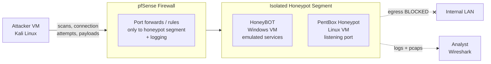

# Honeypot Deployment & Attacker Behaviour Analysis

Low-interaction honeypots (**HoneyBOT** and **PentBox**) were deployed in an isolated network segment behind a **pfSense** firewall. They emulate vulnerable services and record every intrusion attempt. The captured data was analysed with **Wireshark** and the honeypot logs to profile how attackers behave: who connects, which services they target, and what they send.

---

## Table of Contents
1. [What Is a Honeypot and Why Use One?](#1-what-is-a-honeypot-and-why-use-one)
2. [Lab Architecture](#2-lab-architecture)
3. [Tools Used](#3-tools-used)
4. [Deployment](#4-deployment)
5. [Generating and Capturing Attack Traffic](#5-generating-and-capturing-attack-traffic)
6. [Analysis Methodology](#6-analysis-methodology)
7. [Observed Attack Patterns](#7-observed-attack-patterns)
8. [Security Considerations](#8-security-considerations)
9. [Key Takeaways](#9-key-takeaways)
10. [Future Improvements](#10-future-improvements)

---

## 1. What Is a Honeypot and Why Use One?

A **honeypot** is a decoy system with no legitimate users. Because nobody should ever connect to it, **every connection is suspicious by definition**. That gives honeypot data a very high signal-to-noise ratio compared with production logs.

| Type | Interaction | Example | Risk | Data captured |
|---|---|---|---|---|
| **Low-interaction** | Emulates the banner/handshake of a service | HoneyBOT, PentBox | Low: there is no real OS for the attacker to take over | Connection metadata, first payloads, credentials tried |
| High-interaction | A real, fully exploitable OS | A deliberately vulnerable VM | High: needs strict containment | Full attacker sessions, tooling, lateral movement |

This project uses **low-interaction** honeypots. They are safe to run in a home lab and still show the reconnaissance and initial-access stage of an attack, which is where most attacks begin and where defenders get the earliest warning.

**Uses in a SOC:**
- Early warning: a hit on a honeypot inside the network usually means a scanner or a compromised host
- Threat intelligence: source IPs, targeted ports and payloads become IOCs
- Detection engineering: real attack patterns are used to write and tune IDS/SIEM rules

---

## 2. Lab Architecture

**Design principles**
- **Isolation:** the honeypots sit on their own network segment. pfSense **denies all traffic from the honeypot segment to the internal LAN**, so a compromised decoy can't be used as a pivot.
- **Restricted egress:** outbound traffic from the honeypots is blocked except what is strictly needed. This stops a decoy from being abused to attack others.
- **Everything is logged:** firewall logs on pfSense, application logs on each honeypot, and full packet captures on the segment.

| Component | Role |
|---|---|
| pfSense | Gateway, segmentation, inbound rules toward the decoys, firewall logging |
| HoneyBOT (Windows) | Emulates many common Windows/Internet services at once and logs every connection and the bytes received |
| PentBox honeypot (Linux) | Lightweight listener on a chosen port that returns a fake response and logs intrusion attempts |
| Kali Linux | Generates realistic attack traffic (scanning, banner grabbing, brute-force style connections) |
| Wireshark | Packet-level capture and protocol analysis of all honeypot traffic |

---

## 3. Tools Used

### HoneyBOT
A Windows-based, medium/low-interaction honeypot that **opens a large number of TCP/UDP ports at once** and emulates services such as FTP, Telnet, SMTP, HTTP, POP3, NetBIOS/SMB and RDP. Each connection is logged with:
- Timestamp, remote IP and port, local (targeted) port, protocol
- The raw bytes the attacker sent (shown as hex and ASCII)

Because it listens on so many ports, HoneyBOT is especially good at showing **what an attacker probes first** and **which services draw the most attention**.

### PentBox
A security toolkit for Linux whose *Network tools → Honeypot* module starts a fake service on a chosen port. It can be configured with:
- **Fast auto-configuration:** opens a default port with a default "access denied" message
- **Manual configuration:** custom port, custom fake banner/message, a log file, and an optional beep alert on intrusion

PentBox was used as a second, independent sensor, aimed at a single service with a convincing custom banner.

### pfSense + Wireshark
- pfSense provided segmentation and **firewall logs**, which act as a second, independent record of every connection to the honeypots.
- Wireshark gave **packet-level** visibility: full TCP handshakes, payload contents, scan signatures and timing, all of which application logs alone miss.

---

## 4. Deployment

### 4.1 Network segment
1. A dedicated interface/segment was created on pfSense for the honeypots.
2. Firewall rules on that segment:

| # | Action | Source | Destination | Purpose |
|---|---|---|---|---|
| 1 | Pass | Attacker / untrusted net | Honeypot hosts, honeypot ports | Let attackers reach the decoys |
| 2 | Block + log | Honeypot net | LAN net | **No pivoting into the real network** |
| 3 | Block + log | Honeypot net | This Firewall | Protect the management interface |
| 4 | Block + log | Honeypot net | any | No outbound abuse from a decoy |

### 4.2 HoneyBOT
1. Installed on a dedicated Windows VM with a static IP in the honeypot segment.
2. Real services that would conflict on the same ports (for example IIS or file sharing) were disabled, so HoneyBOT could bind them.
3. All service emulation was enabled and logging was turned on. Logs were exported periodically for analysis.
4. Windows Firewall was configured to allow inbound traffic to the emulated ports.

### 4.3 PentBox
1. PentBox was run on a Linux VM in the same segment.
2. Navigation: `2 – Network tools` → `3 – Honeypot` → `2 – Manual configuration`.
3. Configured with a listening port, a fake service banner, and **logging to file enabled**, so every intrusion attempt is saved with its source IP and time.

### 4.4 Capture
- Wireshark (and `tcpdump` where convenient) captured all traffic on the honeypot segment for the whole experiment. The pcaps were saved for offline analysis.

---

## 5. Generating and Capturing Attack Traffic

The lab is isolated, so attack traffic was generated from the Kali VM to reproduce the techniques real internet scanners and bots use:

| Technique | Example | What it imitates |
|---|---|---|
| Host discovery | `nmap -sn <honeypot-net>` | Bots sweeping address ranges for live hosts |
| Port scanning | `nmap -sS -p- <honeypot>` | Mass scanners looking for any open service |
| Service/banner grabbing | `nmap -sV`, `nc <honeypot> <port>` | Identifying software and versions to pick exploits |
| Credential guessing | Repeated logins to Telnet/FTP emulations | Brute-force bots trying default credentials |
| Web probing | HTTP requests for common paths (`/admin`, `/login`, `/phpmyadmin`) | Automated vulnerability crawlers |

Each honeypot logged the attempts on its side, pfSense logged them at the firewall, and Wireshark captured the packets. That gave **three independent views of the same event**.

---

## 6. Analysis Methodology

The data was analysed along three dimensions:

### 6.1 Source IPs (who)
- Grouped connections by source address to separate **one noisy scanner** from many distinct sources.
- Looked at connection timing per source. Evenly spaced, rapid connections point to automated tooling, while irregular gaps suggest a human at a keyboard.

### 6.2 Targeted ports (where)
- Counted connection attempts per destination port to rank **which services attract the most interest**.
- Mapped each port to its service and the threats commonly associated with it:

| Port | Service | Why attackers target it |
|---|---|---|
| 21 | FTP | Anonymous login, cleartext credentials |
| 22 / 23 | SSH / Telnet | Credential brute force; Telnet defaults are a classic IoT-botnet vector |
| 25 | SMTP | Open relays for spam |
| 80 / 8080 | HTTP | Web vulnerability scanning, admin panels |
| 135 / 139 / 445 | RPC / NetBIOS / SMB | Windows enumeration; SMB exploits (e.g. EternalBlue-class worms) |
| 3389 | RDP | Remote-access brute force, a common ransomware entry point |

### 6.3 Connection payloads (what)
- Examined the raw bytes the attacker sent after connecting (HoneyBOT's hex/ASCII view and Wireshark's *Follow TCP Stream*).
- Classified payloads as:
  - **Empty / connect-only:** pure port scanning
  - **Protocol handshakes / banner requests:** service fingerprinting
  - **Credential attempts:** `USER`/`PASS` sequences, login strings
  - **Exploit-like or path-probing requests:** HTTP requests for known vulnerable paths, malformed protocol data

### 6.4 Useful Wireshark filters

| Purpose | Filter |
|---|---|
| All traffic to the honeypots | `ip.dst == <honeypot-ip>` |
| Connection attempts only (SYN) | `tcp.flags.syn == 1 && tcp.flags.ack == 0` |
| Attempts that got a response (open emulated port) | `tcp.flags.syn == 1 && tcp.flags.ack == 1` |
| Cleartext credentials (FTP) | `ftp.request.command == "USER" \|\| ftp.request.command == "PASS"` |
| Telnet sessions | `telnet` |
| HTTP probing | `http.request` |
| Stealth scans (NULL / Xmas) | `tcp.flags == 0x000 \|\| tcp.flags == 0x029` |

*Statistics → Conversations* and *Statistics → Endpoints* in Wireshark were used to rank top talkers and top targeted ports quickly.

---

## 7. Observed Attack Patterns

The analysis produced the following attacker behaviour profile, which matches the typical lifecycle of opportunistic attacks:

1. **Reconnaissance comes first and is the loudest.** Most events were scans, connections with little or no payload that only check whether a port is open. Attackers map the surface before they commit.
2. **Remote-access and file-sharing services draw the most attention.** Telnet/SSH, SMB and RDP were the ports most targeted, because they give the most direct path to control of a machine.
3. **Credential attacks follow open ports.** Once a login-capable service answered, the next step was repeated login attempts with common or default usernames and passwords.
4. **Automation is visible in the timing.** Scans and brute-force attempts showed regular, machine-speed intervals. That is a reliable sign of tooling rather than manual activity.
5. **Cleartext protocols leak everything.** Over FTP and Telnet, every username and password attempt was readable in the capture. This is a direct, visible argument for encrypted protocols.

### IOCs extracted
From the logs and captures, the following indicator types were recorded for each attack session. These are the same artefacts a SOC would feed into a blocklist or SIEM correlation rule:
- Source IP address
- Targeted port/service sequence (the order in which ports were probed)
- Credential pairs attempted
- Distinctive payload strings / HTTP paths / user-agents

---

## 8. Security Considerations

Running a honeypot means **inviting attacks on purpose**, so containment was treated as a requirement:

- **No route to production:** the honeypot segment cannot reach the LAN (pfSense rule #2).
- **No outbound abuse:** decoys cannot start connections to the internet, so they can't join a botnet or attack third parties.
- **Low-interaction only:** no real shell is exposed, so the attacker has nothing to take over.
- **Dedicated VMs, snapshotted:** each honeypot runs on a throwaway VM that can be reverted to a clean snapshot.
- **No real data:** the decoys hold no credentials, files or accounts belonging to real systems.
- **Legal/ethical:** all attack traffic was generated in a lab I own and control.

---

## 9. Key Takeaways

- **High-fidelity alerts:** because nothing legitimate talks to a honeypot, every hit is worth investigating. That is the opposite of a noisy production SIEM.
- **Attackers follow a predictable sequence:** scan, then fingerprint, then credential attack, then exploit. Detecting the early stages buys time.
- **Exposed management services are the top target:** keeping Telnet, SMB and RDP off untrusted networks removes the most attacked surface.
- **Multiple sensors give confidence:** matching honeypot logs against firewall logs and packet captures confirmed each event and removed guesswork.
- **Honeypot output feeds detection engineering:** observed ports, payloads and timing translate directly into IDS signatures and SIEM rules.

---

## 10. Future Improvements

- Deploy **Cowrie** (a medium-interaction SSH/Telnet honeypot) to capture full attacker command sessions
- Ship honeypot logs to **Wazuh / ELK** for dashboards, GeoIP enrichment and alerting
- Add **Snort/Suricata** in front of the honeypots and compare IDS detections with honeypot hits
- Map observed techniques to **MITRE ATT&CK** (e.g. T1046 Network Service Discovery, T1110 Brute Force)
- Automate log parsing with a Python script that outputs top source IPs, ports and payloads

---

## Tech Stack

`HoneyBOT` · `PentBox` · `pfSense` · `Wireshark` · `Nmap` · `Kali Linux` · `Linux` · `Windows`

## Disclaimer

This project was carried out in an isolated lab environment for educational and defensive research purposes. Do not deploy honeypots on networks you don't own or aren't authorised to manage.
